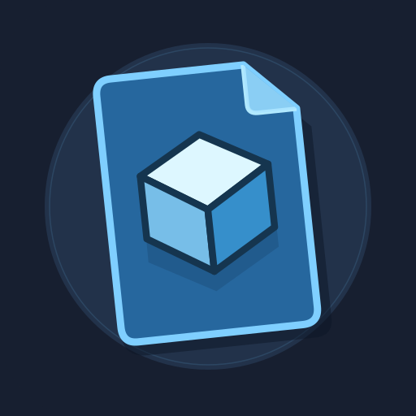

# Axiom Blueprint Items



A Kotlin/Fabric addon that puts saved Axiom blueprints in the creative inventory.
Blueprint items are reusable links to files in your Axiom library.

## Requirements

- Minecraft Java Edition 26.2
- Java 25
- Fabric Loader 0.19.5 or later
- Fabric API 0.161.0+26.2
- Fabric Language Kotlin 1.14.2+kotlin.2.4.21 or later
- Axiom 6.1.3

Supports creative mode in singleplayer and on Axiom-enabled Java servers.
Bedrock clients are not supported.

## Installation

Put the addon jar and its dependencies in your Minecraft instance's `mods` folder.
Install this addon on the client only. A multiplayer server needs its own Axiom
support: Axiom 6.1.3 on Fabric, or a compatible Axiom Paper plugin. The server does
not need this addon or Fabric Language Kotlin for it. Axiom's multiplayer access
rules and the server's permissions still apply.

Use a dedicated server for this client-only setup. Hosting through **Open to LAN**
currently requires connecting players to install this addon too: Fabric shares
the legacy item registrations retained for older singleplayer worlds.

Save blueprints through Axiom as usual, then open the creative inventory and
select **Blueprints**. The tab uses the free bottom-row position before Inventory
when available; otherwise, find it with Fabric's page arrows.

Search by name or select tags. Multiple selected tags must all match.
**Refresh** rereads the library, including nested folders. The filter panel uses
Minecraft GUI textures, so resource packs can change its appearance.

## Placement

Hold **Sneak (Shift by default)** and right-click to place one copy immediately
at the surface you aim at, without opening the movable preview. Your selected
hotbar slot and Axiom tool stay unchanged. Release right-click before placing
another copy; holding it does not keep pasting. Axiom's normal undo works for
these placements too.

Take a blueprint item into your inventory and right-click the air. This starts
Axiom's Clone preview in its tenth hotbar slot and keeps you in creative mode.
The preview starts with its lowest blocks above the surface you aim at, including
while flying beyond normal interaction reach. Targeting follows your aim for up
to 1024 blocks through terrain already loaded on your client. If no block is hit,
the preview starts five blocks in front of you. Release the initial click before
confirming. You can still move the preview downward with Axiom's controls.

- Scroll to move the preview.
- Middle-click to move it to the target.
- Ctrl+R rotates; Ctrl+F flips.
- Right-click places a copy. Move the preview, then right-click to place another.
- Left-click cancels before the first copy, or finishes after placing copies.

The preview stays active until you finish, regardless of your original tool,
just like Axiom's normal Clone tool. Finishing or cancelling returns to your
normal hotbar slot and restores the Axiom tool you had selected before using
the blueprint. On-screen hints show the controls;
**Cancel** changes to **Finish** after the first copy. Finishing keeps the copies
you already placed.

Undo works through Axiom as usual; finish an active repeat-copy preview first.
Manually switching tools during the preview cancels it without pasting and keeps
the tool you chose. Existing builder selections and editor placements must be
finished or cancelled before starting another blueprint.

## Library links

Items store a relative library path and a fallback name, not the build itself.
New links use vanilla paper with vanilla item data, so multiplayer servers can
store and transfer them without registering a custom blueprint item. Their
appearance and placement behavior come from your client addon; players without
it see named paper. Avoid using blueprint links in paper crafting recipes.

Editing the source changes future placements. Moving or deleting the file breaks
the link; the item remains in your inventory and reports the problem. Copy the
matching library files when moving a world to another computer.

The source library stays on each player's computer. Giving someone a link does
not transfer its blueprint file; it works for them only if the same relative
library path exists locally. Existing custom blueprint items from older
singleplayer worlds remain readable. Newly taken items use the portable paper
representation.

Saved entities follow Axiom's **Copy Entities** setting and are included in undo.
Entity-only blueprints are currently unsupported.

## Item previews

With the optional **Mod Menu** mod installed, open **Mods → Axiom Blueprint Items
→ Configure** and choose an **Item previews** preset. Changes apply immediately
and save automatically. Mod Menu 20.0.3 is tested with Minecraft 26.2.

- **High quality** (default): the actual blueprint's textured block models and
  fluids rotate continuously, rendered through Axiom into a 512 × 512 texture
  with linear sampling. Geometry is cached without voxel reduction. Hover over
  an item to see an enlarged rotating preview.
- **Lightweight**: the earlier simplified, shaded voxel miniature. It uses
  Minecraft map colors, at most 24 samples along the longest axis, and 16 cached
  64-pixel views over a four-second rotation. Colors do not follow resource packs.
- **Static**: Axiom's saved thumbnail, without rotation.

High quality reads source files on one background worker and prepares a limited
number of mesh sections per frame. Prepared geometry and framebuffers are reused;
rotation does not reload the blueprint or rebuild its mesh. The cache holds at
most 64 full-detail previews, with a 384 MiB GPU budget and a combined limit of
16,777,215 retained blocks. This mode costs more than Lightweight or Static.

High quality follows resource-pack block models and textures. It uses Axiom's
native block-and-fluid preview renderer; separate saved entities and special
block-entity renderers are not included in item images. Placement behavior is
unchanged. Sources remain limited to 128 MiB and 4096 source sections.

A saved thumbnail appears during loading or when a full-detail preview cannot be
prepared within the renderer/cache limits. The enlarged preview labels loading
and unavailable states. It never substitutes reduced voxel geometry for the High
quality preset. Source edits are reread when the library is refreshed; unchanged
sources keep their ready previews. Graphics resources are released on resource
reload and shutdown.

Lightweight generation is separately limited to 32 MiB source files, 32 MiB of
accounted build NBT, and 512 source sections. Its atlas cache holds 64 rotating
previews, using about 16 MiB of GPU textures and 16 MiB of image pixels. Its disk
cache is limited to 32 MiB and 512 files under
`.cache/axiom-blueprint-items/previews` in the game directory. Missing or invalid
saved images use a paper icon. Deleting this cache is safe.

Without Mod Menu, edit `previewStyle` in `config/axiom-blueprint-items.json` to
`"high_quality"`, `"lightweight"`, or `"static"`, then restart Minecraft. Older
`animatedPreviews: false` preferences remain Static; older enabled preferences
upgrade to High quality. Unknown configuration fields are preserved.

## Building

With JDK 25 installed:

```sh
./gradlew clean build --warning-mode all
```

The jar is written to `build/libs/`. Run the isolated client regression test with
`./gradlew runClientGameTest --warning-mode all`, or launch the development client
with `./gradlew runClient`. Mod Menu is included only in the development runtime;
the addon does not bundle or require it. Test without Mod Menu using
`./gradlew runClientGameTest -PwithModMenu=false --warning-mode all`.

The build fetches Axiom for development; it does not bundle Axiom in the addon.
Kotlin and Java compiler warnings are treated as errors.

## License

Licensed under the [MIT License](LICENSE).
Axiom, the Gradle wrapper, and other third-party dependencies retain their own licenses.
